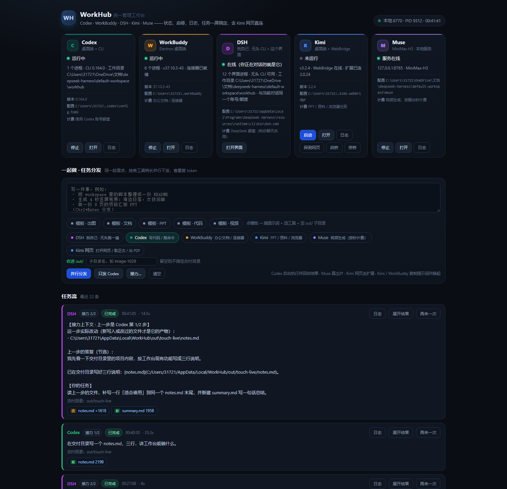

# WorkHub

**One local web console for Codex, WorkBuddy, DSH, Kimi and Muse.**

Send one task to several agents at once, collect every artifact under `out/`, and see what is running,
what failed, and what it costs — on a single page. Zero third-party dependencies, bound to `127.0.0.1` only,
jobs run in the background on your own machine.



## Why

If you keep several "AI workbenches" open, you know the drill: five windows, the same request typed five times,
no idea which quota is being burned, and outputs scattered across five download folders. Half of the tools
have a GUI but no API, so scripting them is a dead end.

WorkHub turns that into one page: **status cards** manage processes, the **task bench** dispatches work,
the **artifact directory** collects deliverables.

## What it does

| | Status / start-stop | Can take tasks | Deliverables |
| --- | --- | --- | --- |
| **Codex** | process + CLI version | ✅ real background `codex exec` | files under `out/<dir>`, clickable |
| **WorkBuddy** | process + version | ⚠️ semi-auto: copy prompt + focus app | you save it in the app |
| **DSH** | process + headless CLI | ✅ real background `dsh headless` | files under `out/<dir>` |
| **Kimi** | process + WebBridge daemon | ✅ web tasks: text / screenshot / PDF | screenshots and PDFs in `out/kimiweb/` |
| **Muse** | local service on 8765 | ✅ real video generation (billed per output second) | inline player + mp4 link |

Tools without a task interface are not faked: WorkBuddy is explicitly marked as semi-automatic.

## Quick start

Requires **Python 3.10+**, no dependencies.

```bash
git clone https://github.com/Elias1222/workhub.git
cd workhub
python -m workhub --open          # http://127.0.0.1:8770/
```

Or install the console script:

```bash
python -m pip install -e .
workhub --open
```

On Windows, `scripts\workhub.cmd` runs it in a console and `scripts\launch.vbs` starts it silently.

## Usage

1. Pick a template (image / doc / deck / code / video) — it fills the prompt and the delivery directory
   `out/<prefix>-MMDD-HHMM`.
2. Tick the tools you want; the same prompt can go to Codex and DSH at once.
3. `Ctrl+Enter` to dispatch. Each tool gets its own card with live status, elapsed time and a cancel button;
   results, file chips, image and video previews land on that card.
4. Everything is under `out/`, served through `/artifact` (path traversal is blocked).

Finished jobs can be re-run with "again"; "log" shows the raw output of that invocation.

### Chains (hand-off)

Parallel is for "ask several models the same question". "Research first, then write" has to run in order.
Hit **接力…** and lay out a 2–5 step chain:

- a step only starts when the previous one **succeeded**; failure / cancel / interrupt marks the rest
  as *skipped* with the reason, so nothing silently half-runs;
- the next step's prompt automatically gets a `【接力上下文】` block with the previous step's product
  paths and the first 1200 characters of its answer;
- use `{files}` (absolute product paths) or `{prev}` (previous answer) in a prompt to place them yourself;
- only targets that **return a result** can join a chain (Codex / DSH / Muse / Kimi web); Kimi's desktop
  app and WorkBuddy are manual hand-offs, and are rejected up front instead of failing mid-chain;
- cards show a `接力 2/3` badge, waiting steps read *waiting*, skipped ones read *skipped*.

When a step finishes, the delivery directory is compared against the snapshot taken before it started,
so the card says what **this step** actually did:

```
new notes.md 219B        changed notes.md +161B        new summary.md 195B        deleted draft.md
```

Those — not the whole directory — are what travels to the next step: leftovers from earlier steps in the
same folder are not mistaken for this step's product, and `{files}` expands to exactly these paths.

### Delivery directory

When Codex or DSH gets an `out/` subdirectory, the child process **starts with that directory as its cwd**
and the prompt says "write deliverables here, read reference files from the original workspace by absolute path".
That combination is what actually works — prompt-only instructions get ignored and files end up in the workspace.

### Kimi web tasks

Kimi's desktop app has no general task API, so web tasks go through
[Kimi WebBridge](https://www.kimi.com/products/kimi-webbridge): run the daemon, install the browser extension,
connect it from the Kimi sidebar (Settings → Local remote control → `ws://127.0.0.1:10086/ws`), then press
"probe" in the Kimi card. The first line of the prompt is the URL; pick a mode (text+shot / text / PDF / shot).

### DSH card

DSH is DeepSeek Harness itself. Its key is read from `~/.dsh/.credentials.yaml` (`refs.DEEPSEEK_API_KEY`) and
injected **only** into the child process environment — never written to disk, never returned to the browser.

## Configuration

Priority: **environment variables > `<data dir>/config.json` > built-in defaults**. Defaults only guess likely
paths; if something is missing the card says "not found" and you fix it in config.

```bash
WORKHUB_DATA=...        # data dir (jobs, logs, artifacts); Windows %LOCALAPPDATA%\WorkHub, else ~/.workhub
WORKHUB_WORKDIR=...     # default working dir for Codex / DSH
WORKHUB_OUT=...         # artifact root, default <data>/out
WORKHUB_PORT=8770
WORKHUB_HOST=127.0.0.1
WORKHUB_TOKEN=...       # when set, /api and /artifact require a token
```

Per-tool overrides: `WORKHUB_CODEX_CLI`, `WORKHUB_CODEX_NODE_DIR`, `WORKHUB_WORKBUDDY_EXE`, `WORKHUB_KIMI_EXE`,
`WORKHUB_KIMI_BRIDGE`, `WORKHUB_KIMI_WEB`, `WORKHUB_MUSE_DIR`, `WORKHUB_MUSE_PORT`, `WORKHUB_DSH_CLI`,
`WORKHUB_DSH_EXE`, `WORKHUB_DSH_JS`, `WORKHUB_DSH_CREDS`, `WORKHUB_DSH_GUI`.
See [examples/config.example.json](examples/config.example.json).

```text
python -m workhub [--host 127.0.0.1] [--port 8770] [--open] [--token TOKEN] [--data-dir DIR] [--debug]
python -m workhub --version
```

## HTTP API

| Method | Path | Description |
| --- | --- | --- |
| GET | `/healthz` | `ok`, cheap liveness check |
| GET | `/api/state` | the five cards + recent jobs |
| GET | `/api/templates` | prompt templates + artifact root |
| GET | `/api/job/log?id=&lines=` | tail of that invocation's log |
| GET | `/api/kimi/probe` | WebBridge daemon / extension / version report |
| GET | `/artifact?path=` | serve a file under `out/` (403 outside) |
| POST | `/api/task` | `{prompt, targets, muse, codex, kimiweb, dsh}` |
| POST | `/api/chain` | `{steps:[{target,prompt}], outdir, title}` — a 2–5 step chain |
| POST | `/api/action` | `{target, action}` start / stop / open / bridge |
| POST | `/api/job/<id>/cancel` \| `/retry` | cancel or re-run a job |

```bash
curl -s -X POST http://127.0.0.1:8770/api/task \
  -H 'Content-Type: application/json' \
  -d '{"prompt":"write a 5-line README.md","targets":["codex"],"codex":{"outdir":"doc-1028"}}'
```

## Security

- Loopback only by default. Binding a non-loopback host without `--token` refuses to start.
- With a token, `/api/*` and `/artifact` need `X-WorkHub-Token` or `?token=`; `/` and `/healthz` stay public.
- `/artifact` resolves the path and requires it to live under `out/`.
- No credentials are stored; the DSH key lives only in a child process environment.

## Development

```bash
python -m pip install -e ".[dev]"
ruff check .
python -m unittest discover -s tests -t . -v
```

CI runs lint + tests on Linux/macOS/Windows across Python 3.10–3.13, and builds a wheel.

Design notes: [docs/design.md](docs/design.md).

## License

[MIT](LICENSE). All third-party apps and APIs belong to their vendors; this project only orchestrates them locally.
